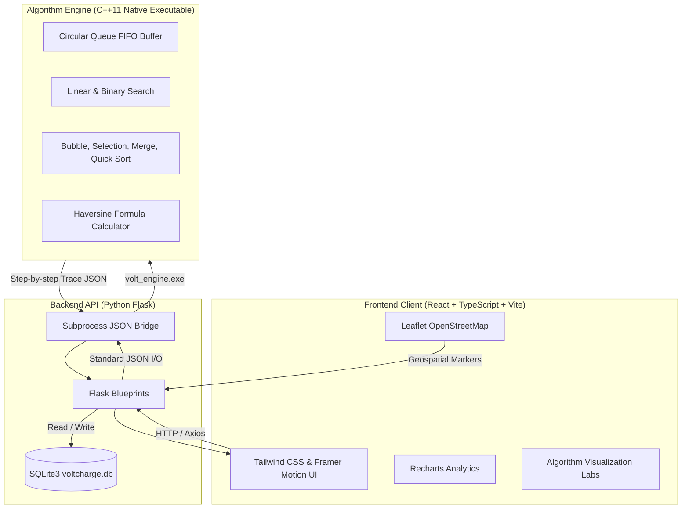

# ⚡ Volt-Charge
### Smart EV Charging Navigation & Data Structures Visualization Platform

**Volt-Charge** is a full-stack, algorithm-driven Smart Electric Vehicle (EV) Charging Navigation and Fleet Queue Management application. It demonstrates how traditional **Data Structures and Algorithms (DSA)** solve modern, real-world transportation and fleet coordination challenges.

The system integrates a high-performance **C++ Native Algorithm Engine**, a **Python Flask REST API**, an **SQLite Database**, and a responsive **React 18 + TypeScript + Vite** frontend styled with **Tailwind CSS**, **Framer Motion**, **Recharts**, and **Leaflet OpenStreetMap**.

---

## 🌟 Key Highlights

- **Custom C++ Algorithm Engine**: Pure manual implementations of a Circular FIFO Queue, Linear Search, Binary Search, Bubble Sort, Selection Sort, Merge Sort, Quick Sort, and the Haversine Spherical Distance Formula.
- **Interactive Algorithm Laboratory**: Step-by-step visual animation of algorithm execution, displaying memory states, pointer movements, comparisons, swaps, pseudocode traces, and asymptotic complexities.
- **Geospatial Station Discovery**: Real-time OpenStreetMap integration via Leaflet with dynamic distance calculation, port availability pins, and radius filtering.
- **Circular Queue Simulator**: Visual ring buffer demonstrating O(1) time complexity for enqueue and dequeue operations, complete with front/rear wrapping pointer visualization and overflow/underflow safeguards.
- **Fleet Analytics Telemetry**: Recharts dashboard analyzing charger utilization, energy delivered, wait times, and algorithmic benchmarks across dataset sizes from 10 to 1,000 nodes.
- **Persistent Data Store**: Station CRUD and vehicle dispatch history persisted in SQLite with schema seeding.

---

## 🏗️ System Architecture



---

## 📐 Data Structures & Algorithms Implementation

| Algorithm / Data Structure | Module | Time Complexity (Best / Avg / Worst) | Space Complexity | Practical Use Case |
| :--- | :--- | :--- | :--- | :--- |
| **Circular Queue (Ring Buffer)** | `algorithms/queue/` | **O(1) / O(1) / O(1)** | O(N) | Enqueuing & dequeuing EVs awaiting charger ports using pointer arithmetic `(idx + 1) % N` without shifting elements. |
| **Haversine Distance Formula** | `algorithms/nearest_station/` | **O(1)** per station | O(1) | Great-circle distance computation over spherical Earth (R = 6,371 km) between GPS coordinates. |
| **Nearest Station Scan** | `algorithms/nearest_station/` | **O(n) / O(n) / O(n)** | O(1) | Linear minimum-distance scan over all geographical stations relative to user coordinates. |
| **Linear Search** | `algorithms/searching/` | **O(1) / O(n) / O(n)** | O(1) | Unsorted search across station ID, name, or locality. |
| **Binary Search** | `algorithms/searching/` | **O(1) / O(log n) / O(log n)** | O(1) | Divide-and-conquer lookup over sorted station indices. |
| **Bubble Sort** | `algorithms/sorting/` | **O(n) / O(n²) / O(n²)** | O(1) | Elementary comparison sort; used for baseline academic benchmarking. |
| **Selection Sort** | `algorithms/sorting/` | **O(n²) / O(n²) / O(n²)** | O(1) | Sorting stations by waiting time minimizing total memory swap operations. |
| **Merge Sort** | `algorithms/sorting/` | **O(n log n) / O(n log n) / O(n log n)** | O(n) | Guaranteed O(n log n) stable sorting by geographical proximity or available ports. |
| **Quick Sort** | `algorithms/sorting/` | **O(n log n) / O(n log n) / O(n²)** | O(log n) | High-performance in-place sorting for large charging station registries. |

---

## 📂 Project Repository Structure

```
volt-charge/
│
├── algorithms/                    # C++ Algorithm Engine
│   ├── common/
│   │   ├── json.hpp              # nlohmann JSON single-header library
│   │   └── json_helper.h         # JSON input/output serialization helper
│   ├── queue/
│   │   ├── circular_queue.h      # Circular Queue class header
│   │   └── circular_queue.cpp    # Circular Queue array implementation
│   ├── searching/
│   │   ├── search.h              # Search declarations & Station struct
│   │   └── search.cpp            # Linear & Binary search with step tracking
│   ├── sorting/
│   │   ├── sort.h                # Sorting headers & SortResult struct
│   │   └── sort.cpp              # Bubble, Selection, Merge, Quick Sort implementations
│   ├── nearest_station/
│   │   ├── nearest.h             # Haversine distance header
│   │   └── nearest.cpp           # Haversine formula & nearest scan
│   ├── CMakeLists.txt            # CMake build configuration
│   ├── main.cpp                  # CLI entry point dispatching JSON commands
│   └── volt_engine.exe           # Compiled C++ binary
│
├── backend/                       # Python Flask REST API
│   ├── database/
│   │   ├── db.py                 # SQLite initialization, schema & seeders
│   │   └── voltcharge.db         # Persistent SQLite database
│   ├── routes/
│   │   ├── stations.py           # Station CRUD routes
│   │   ├── algorithms.py         # Algorithm execution routes
│   │   └── analytics.py          # Telemetry & benchmark routes
│   ├── services/
│   │   ├── algorithm_service.py  # Subprocess communication bridge with C++ engine
│   │   ├── station_service.py    # Business logic & validations
│   │   └── queue_service.py      # Circular queue lifecycle manager
│   ├── app.py                    # Main Flask application
│   └── requirements.txt          # Python dependencies (flask, flask-cors)
│
├── frontend/                      # React + TypeScript + Vite Application
│   ├── src/
│   │   ├── animations/           # Framer Motion animation variants
│   │   ├── components/
│   │   │   ├── algorithms/       # QueueLab, SearchLab, SortLab, NearestLab, Info
│   │   │   ├── layout/           # Sidebar, Header, MainLayout
│   │   │   ├── map/              # Leaflet StationMap with custom pins
│   │   │   ├── queue/            # VehicleCard, QueueControls, QueueVisualizer
│   │   │   ├── stations/         # StationCard, StationFormModal
│   │   │   └── ui/               # Badge, Modal, StatCard, Toast, Spinner, EmptyState
│   │   ├── context/              # AppContext global state provider
│   │   ├── pages/                # Dashboard, FindStations, QueueSimulator, etc.
│   │   ├── services/             # Axios API service clients
│   │   ├── types/                # Strict TypeScript interface definitions
│   │   └── visualizers/          # BarVisualizer, StepController
│   ├── package.json              # Frontend dependencies
│   ├── tailwind.config.js        # Design tokens & color system
│   └── vite.config.ts            # Vite proxy & bundler settings
│
├── data/
│   ├── stations.json             # Baseline simulated charging hubs
│   └── vehicles.json             # Initial EV fleet records
│
├── docs/
│   ├── ALGORITHMS.md             # Pseudocode & detailed DSA documentation
│   └── API.md                    # REST API endpoint reference
│
├── tests/
│   └── test_all.py               # Comprehensive 19-test automated test suite
│
└── README.md
```

---

## 🚀 Quick Start (Single Command / One-File Execution)

You can launch the **entire platform** by running `app.py` directly:

```powershell
cd "d:\DS cp\volt-charge\backend"
python app.py
```

`app.py` automatically executes all three steps:
1. **Runs the automated test suite** (verifies C++ engine, queues, searching, sorting, and Haversine formula).
2. **Starts the React + Vite frontend** (`http://localhost:3000`).
3. **Starts the Flask backend API** (`http://localhost:5000`) and automatically opens your browser!

Alternatively, you can also run:
```powershell
.\run.bat    # or .\run.ps1
```

---

## 🛠️ Manual Setup & Execution Guide

### Prerequisites
- **Node.js**: v18+ (tested with v22)
- **Python**: v3.9+ (tested with Python 3.14)
- **C++ Compiler**: GCC / MinGW / Clang (C++11 compatible)

---

### Step 1: Compile the C++ Engine (Optional - Pre-compiled executable included)
```powershell
cd "d:\DS cp\volt-charge\algorithms"
g++ -std=c++11 -O2 -I. -Icommon -Iqueue -Isearching -Isorting -Inearest_station main.cpp queue/circular_queue.cpp searching/search.cpp sorting/sort.cpp nearest_station/nearest.cpp -o volt_engine.exe
```

---

### Step 2: Set Up & Launch the Backend API
```powershell
cd "d:\DS cp\volt-charge\backend"
python -m pip install -r requirements.txt
python app.py
```
Backend will start on `http://localhost:5000`. On startup, it automatically creates and seeds `voltcharge.db` from `data/stations.json`.

---

### Step 3: Launch the Frontend Development Server
```powershell
cd "d:\DS cp\volt-charge\frontend"
npm install
npm run dev
```
Open your browser at `http://localhost:5173` or `http://localhost:3000`.

---

### Step 4: Run the Automated Test Suite
```powershell
cd "d:\DS cp\volt-charge"
python tests/test_all.py
```
This runs 19 automated tests covering:
- C++ Circular Queue enqueue, dequeue, peek, underflow, overflow, and circular wraparound
- Linear and Binary search (first element, last element, not found, empty set)
- Bubble, Selection, Merge, and Quick Sort verification and edge cases
- Haversine distance calculation and identical coordinates
- Backend station CRUD lifecycle, missing field validations, and telemetry endpoints

---

## 📡 REST API Reference

| Method | Endpoint | Description | Payload / Query |
| :--- | :--- | :--- | :--- |
| `GET` | `/api/health` | Healthcheck & C++ engine status | None |
| `GET` | `/api/stations` | Retrieve stations with optional filters | `?search=&chargingType=&available=&sortBy=` |
| `GET` | `/api/stations/:id` | Retrieve single station by ID | None |
| `POST` | `/api/stations` | Create new charging station | Station JSON object |
| `PUT` | `/api/stations/:id` | Update existing station | Partial station JSON |
| `DELETE` | `/api/stations/:id` | Delete station from database | None |
| `POST` | `/api/algorithms/nearest` | Find nearest station via Haversine | `{"userLat": 28.6139, "userLon": 77.2090}` |
| `POST` | `/api/algorithms/search` | Search stations with Linear or Binary Search | `{"algorithm": "linear_search", "key": "ST001", "field": "id"}` |
| `POST` | `/api/algorithms/sort` | Sort stations with Bubble/Selection/Merge/Quick | `{"algorithm": "merge_sort", "criteria": "waitingTime"}` |
| `POST` | `/api/algorithms/queue` | Dispatch Circular Queue operations | `{"operation": "enqueue", "vehicle": {...}}` |
| `GET` | `/api/analytics` | Telemetry, utilization & benchmark data | None |

---

## 🔬 Algorithm Pseudocode

### 1. Haversine Distance (C++)
```cpp
double calculateDistance(double lat1, double lon1, double lat2, double lon2) {
    double dLat = toRadians(lat2 - lat1);
    double dLon = toRadians(lon2 - lon1);
    double a = sin(dLat / 2) * sin(dLat / 2) +
               cos(toRadians(lat1)) * cos(toRadians(lat2)) *
               sin(dLon / 2) * sin(dLon / 2);
    double c = 2.0 * atan2(sqrt(a), sqrt(1.0 - a));
    return 6371.0 * c; // Earth radius in km
}
```

### 2. Circular Queue FIFO Enqueue & Dequeue (C++)
```cpp
bool enqueue(Vehicle v) {
    if (count == MAX_CAPACITY) return false; // Overflow
    rear = (rear + 1) % MAX_CAPACITY;
    data[rear] = v;
    count++;
    return true;
}

Vehicle dequeue() {
    if (count == 0) throw UnderflowException();
    Vehicle v = data[front];
    front = (front + 1) % MAX_CAPACITY;
    count--;
    return v;
}
```

---

## 🎯 Future Scope

1. **Graph Routing Algorithms**: Implementation of Dijkstra's and A* pathfinding to compute multi-stop navigation between EV charging corridors.
2. **Dynamic Pricing & Load Balancing**: Priority queues with min-heaps to balance power grid load during peak electricity tariff hours.
3. **Live Hardware WebSockets**: Real-time OCPP (Open Charge Point Protocol) integration for production charging stations.
4. **Mobile Application**: Cross-platform React Native deployment for in-car Android Automotive OS and Apple CarPlay dashboards.

---

## 📜 License
Developed for educational evaluation, technical demonstrations, and open-source EV software architecture.
